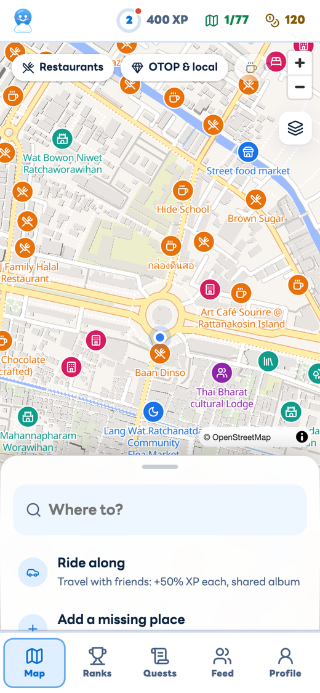
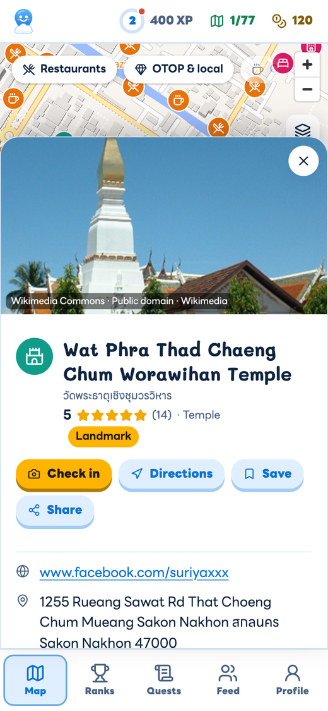
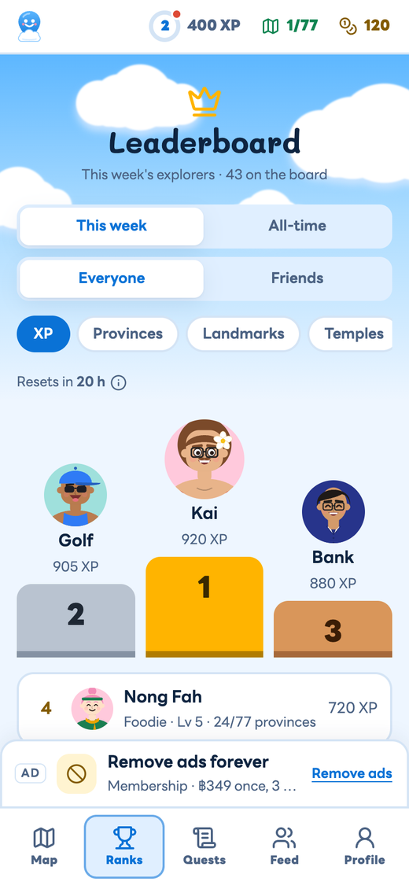
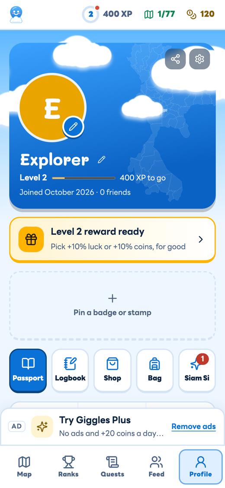
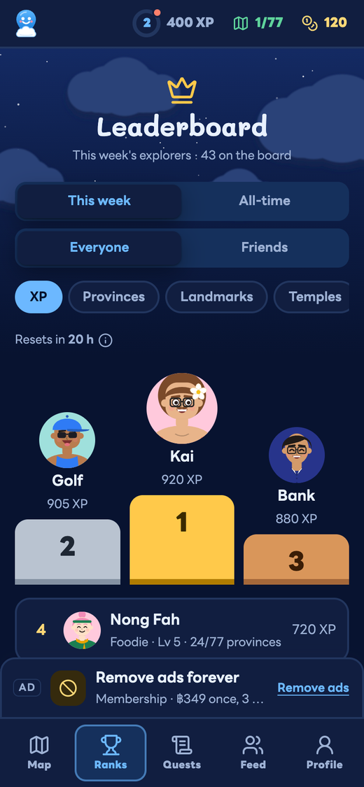
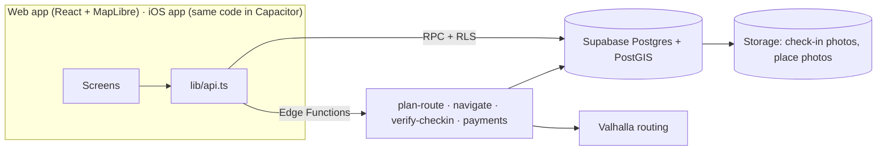

<p align="center">
  
</p>

<p align="center">
  <a href="https://giggles-maps.pages.dev"></a>
  
  
  
  
  
  
</p>

**Giggles Maps** turns the spare minutes on a trip into a mini adventure. Say where you're going and how much extra time
you're OK with: it plans a route through the best local stops on the way, across all 77 provinces of Thailand (temples,
viewpoints, cafés, OTOP craft shops), ranked on quality, with paid Partners always labelled. At each stop you check in with a photo and collect passport
stamps, XP, coins and Siam Si fortune sticks. Shops pay only for visits that really happened.

<p align="center"><br />
  <sub><a href="docs/assets/hype.mp4">Watch the 10-second clip with sound</a> · <a href="docs/assets/hype-9x16.mp4">vertical cut for Reels and TikTok</a></sub></p>

<p align="center">
  
  
  
  
  <br />
  <sub>Screens from demo mode: the other travellers, reviews and partners are pretend.</sub>
</p>

## What it does

| | |
|---|---|
| 🧭 **Detours that fit your time** | Quick (+20 min), Relaxed (+45 min), Half day or Day out, each already planned on real road times, with the arrival and leave time at every stop. Add a stop between any two, or drag to reorder: the route follows. |
| 📍 **Check in, collect Thailand** | A photo at the stop stamps your passport: a visa for each of the 77 provinces, landmark stamps, a logbook of every visit. |
| 🎋 **Siam Si fortune sticks** | Every new place earns a shake of the เซียมซี cup: coins, XP boosts or cosmetics, with published odds and pity. |
| ⬆️ **Level-up rewards** | Each level lets you pick a permanent perk, +10% luck or +10% coins, and unlocks a sky-themed cosmetic. |
| ✍️ **Give back, get rewarded** | A written review of a place you visited earns a Siam Si shake; your first photo of a stop on its page earns coins. |
| 🏆 **Play with friends** | Weekly and all-time leaderboards, province champions, quests and chests, a friends feed, ride-along trips with live positions and a shared album. |
| 🌙 **Dark mode** | Light, Dark, or Auto (follows your phone). The map goes dark with it. |
| 🏪 **For shops** | Claim your listing free, add products and photos, see how many trips pass your door. Partners (฿299/month) show first on members' routes, always labelled, and take bookings. |

## How it works



- **Planner.** `plan-route` shortlists places along the road corridor in PostGIS, gets real road times from Valhalla,
  then picks and orders stops to fill your budget (insertion + 2-opt). Meal windows are respected; opening hours are not used yet (we have no trustworthy hours data).
  [Algorithm notes](docs/ARCHITECTURE.md) · [Thailand routing](docs/THAILAND-ROUTING.md)
- **Trust.** Clients never write XP, coins, stamps or money. Every reward is a server function behind row-level security,
  check-ins are GPS-zoned and speed-checked, and payments arrive only through signed webhooks.
- **Privacy.** No face recognition anywhere; photos live in your own storage folder and are removed when you delete your account.

## Tech

| Layer | Stack |
|---|---|
| Web | React 18, TypeScript, Vite, MapLibre GL, OpenFreeMap tiles, offline Protomaps packs |
| iOS | Capacitor 8 shell + Swift plugins (App Attest, StoreKit 2, Live Activities, location) |
| Backend | Supabase: Postgres + PostGIS, Auth, Storage, Deno Edge Functions |
| Routing | Valhalla (OpenStreetMap) |
| Hosting | Cloudflare Pages |

## Repository

```
web/        landing page, web app (/app) and shop dashboard (/shop); tools/ renders the brand images
ios/        the iOS app: Capacitor shell, Swift plugins, widgets
android/    native Android app (Kotlin + Compose), see android/AGENTS.md
supabase/   migrations, Edge Functions, SQL tests
docs/       architecture, API contract, platforms, monetization, gamification
marketing/  the 10-second hype clip in HyperFrames: hype/ (16:9) and hype-vertical/ (9:16)
```

## Run it

```bash
cd web
cp .env.example .env   # Supabase URL + publishable key
npm install
npm run dev            # http://localhost:5173/app/
```

<details>
<summary>iOS, backend, tests and deploy</summary>

```bash
# iOS (Capacitor): build the web app into the shell, then run the App scheme in Xcode
cd web && npm run ios && open ../ios/App/App.xcodeproj

# backend
supabase link --project-ref xrlxfvwrkowaybtkkrdl
supabase db push                               # migrations
supabase functions deploy --use-api            # edge functions

# tests
cd supabase/functions/_shared && bun test      # planner, corridor, navigation
cd web && bun test src                         # app logic
supabase db query --linked -f supabase/tests/level_rewards.sql   # reward rules, rolled back

# deploy the web app
cd web && npm run build && npx wrangler pages deploy dist --project-name giggles-maps --branch main
```

Edge Function secrets (`supabase secrets set`): `CRON_SECRET`, `SITE_URL`, `STRIPE_SECRET_KEY`, `STRIPE_WEBHOOK_SECRET`,
`VALHALLA_URL`.

Offline province maps are Protomaps packs in the R2 bucket `giggles-maps-offline`; rebuild with
`python3 supabase/tools/offline_packs.py --build <YYYYMMDD> --upload` (needs the `pmtiles` CLI).
</details>

## Docs

[Architecture](docs/ARCHITECTURE.md) · [API contract](docs/API.md) · [Gamification](docs/GAMIFICATION.md) ·
[Monetization](docs/MONETIZATION.md) · [iOS vs Android](docs/PLATFORMS.md) · [Android roadmap](docs/ANDROID-ROADMAP.md) ·
[App Store](docs/APPSTORE.md) · Contributors and coding agents: start at [AGENTS.md](AGENTS.md)

## Credits

Place data and routing © OpenStreetMap contributors (ODbL) · map tiles: OpenFreeMap, Protomaps ·
fonts: LINE Seed Sans TH, Mali, IBM Plex Mono (SIL OFL 1.1) · icons: Lucide (ISC) · clip music: "Whimsy Groove" by
Kevin MacLeod (incompetech.com), CC BY 4.0.
